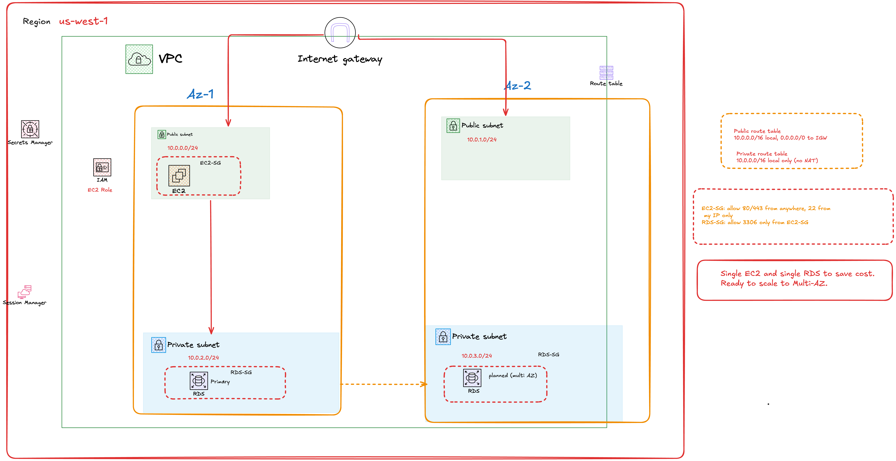

# TechHealth Patient Portal — AWS Infrastructure (CDK)

Infrastructure as Code for migrating the TechHealth Inc. patient portal to AWS, built with **AWS CDK (TypeScript)**. The stack provisions a segmented network, an application server, and a private, encrypted MySQL database, with access designed around least privilege.

| | |
|---|---|
| **IaC** | AWS CDK v2 (TypeScript) |
| **Region** | us-west-1 (2 Availability Zones) |
| **Services** | VPC · EC2 · RDS for MySQL · Secrets Manager · IAM · Systems Manager |

---

## Architecture



### Network layout

| Subnet | CIDR | Type | Purpose |
|---|---|---|---|
| Public subnet (AZ-1) | 10.0.0.0/24 | Public | Application server (EC2) |
| Public subnet (AZ-2) | 10.0.1.0/24 | Public | Reserved for scale-out |
| Private subnet (AZ-1) | 10.0.2.0/24 | Private isolated | Database (RDS primary) |
| Private subnet (AZ-2) | 10.0.3.0/24 | Private isolated | Database subnet group / planned Multi-AZ standby |

### Resources

| Resource | Configuration |
|---|---|
| VPC | 10.0.0.0/16, 2 AZs, internet gateway, **no NAT gateway** |
| EC2 | t3.micro, Amazon Linux 2023, public subnet |
| RDS | MySQL 8.4, db.t3.micro, 20 GB, encrypted, private subnet |
| Secrets Manager | Auto-generated database credentials |
| IAM role | Attached to EC2: Session Manager access + read the DB secret |

---

## Security design

| Control | How it is implemented |
|---|---|
| Database isolation | RDS runs in private isolated subnets with public access disabled. No route to or from the internet. |
| Least-privilege network access | RDS security group allows port **3306 only from the EC2 security group**, not from an IP range. RDS outbound traffic is disabled. |
| Restricted administration | SSH (22) limited to a single administrator IP. Session Manager enabled, so access works without SSH keys. |
| No hardcoded credentials | DB password generated at deploy time and stored in Secrets Manager. The EC2 role can read that one secret only. |
| Encryption at rest | RDS storage encryption enabled. |
| Instance identity | EC2 uses an IAM role (temporary credentials), never access keys. |

### Security group rules

| Security group | Inbound | Source |
|---|---|---|
| EC2-SG | HTTP 80, HTTPS 443 | 0.0.0.0/0 |
| EC2-SG | SSH 22 | Administrator IP (/32) only |
| RDS-SG | MySQL 3306 | EC2-SG only |

---

## Design decisions and tradeoffs

| Decision | Reason | Production path |
|---|---|---|
| No NAT gateway | Saves ~$32/month per AZ; the database never needs internet access | Add NAT or VPC endpoints if private workloads need outbound access |
| Single EC2 instance | Keeps the dev environment cost-efficient | Application Load Balancer + Auto Scaling group across both AZs |
| Single-AZ RDS | Network is already Multi-AZ ready; standby not needed in dev | Set `multiAz: true` for automatic failover |
| `RemovalPolicy.DESTROY` | `cdk destroy` removes everything cleanly, no leftover snapshots | Use `SNAPSHOT` or `RETAIN` with deletion protection |

---

## Deploy

**Prerequisites:** Node.js, AWS CLI configured, AWS CDK v2

```bash
npm install
cdk bootstrap     # first time per account/region
cdk synth         # generate CloudFormation
cdk diff          # preview changes
cdk deploy
```

### Stack outputs

| Output | Description |
|---|---|
| `EC2PublicIp` | Public IP of the application server |
| `RdsEndpoint` | Private endpoint of the MySQL database |
| `DbSecretName` | Secrets Manager secret holding the DB credentials |

### Connect to the database from EC2

```bash
sudo dnf install -y mariadb105
mysql -h <RdsEndpoint> -u admin -p
```

Password: Secrets Manager → `<DbSecretName>` → Retrieve secret value.

---

## Tear down

```bash
cdk destroy
```

The environment is destroyed when not in use and redeployed on demand. The code is the source of truth.

---

## Verified in a live deployment

| Check | Result |
|---|---|
| CloudFormation stack | `CREATE_COMPLETE` |
| EC2 instance | Running in public subnet |
| RDS instance | Available, not publicly accessible |
| Subnets | Public and private across two AZs |
| RDS security group | Inbound 3306 from EC2 security group only |

---

## Roadmap

| Next step | Benefit |
|---|---|
| ALB + Auto Scaling group, instances in private subnets | High availability, no public instances |
| HTTPS with ACM certificate | Encrypted traffic in transit |
| Multi-AZ RDS + backup retention | Automatic database failover |
| Remove SSH rule (Session Manager only) | Smaller attack surface |
| CloudWatch alarms | Alerts on CPU, connections, storage |
| GitHub Actions CI/CD | `cdk diff` on pull requests, `cdk deploy` on merge |

---

## Project structure

```
bin/techhealth-cdk.ts          # App entry point
lib/techhealth-cdk-stack.ts    # VPC, security groups, IAM role, EC2, RDS
test/techhealth-cdk.test.ts    # Stack tests
diagram.png                    # Architecture diagram
cdk.json                       # CDK configuration
```

---

**Author:** Fatuma Abdo · [LinkedIn](https://www.linkedin.com/in/fatuma-abdo-3b729a3a4)

